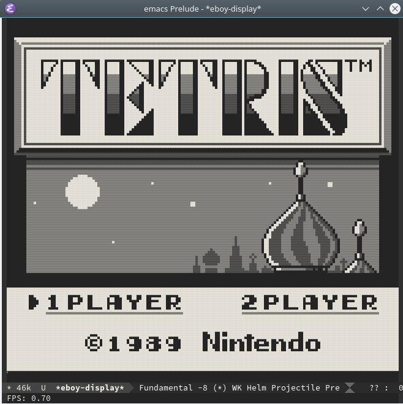

# Eboy - Emacs Gameboy Emulator

A Nintendo Gameboy emulator for Emacs.
This is a work in progress!
Just got Tetris starting up, not tested with anything else.



It currently runs a constant loop without delay.
To get out of this loop, use the common `C-g` command.

The display is drawn using unicode, by default it is set for dark theme.
Use the unicode list below when you have a light theme installed in Emacs.

``` emacs-lisp
(setq eboy-display-unicode-list eboy-display-unicode-list-light-theme)
```

It has frameskip enabled, by default set to 20.

## Why?
I always wanted to learn how to a make an emulator and want learn how to write packages for Emacs.
So here my first emulator and first emacs package.

## Prerequisites

Emacs :)

## Installing

Emacs 29 or newer can install it straight from GitHub:

``` emacs-lisp
(package-vc-install "https://github.com/vreeze/eboy")
```

This byte-compiles it, and if your Emacs has native compilation it is
native-compiled in the background as well. That matters a lot here: run
uncompiled, eboy is about 5 times slower.

## Usage

Load a rom using the `M-x eboy-load-rom` command.

  | Gameboy     | Eboy     |
  |------------:|---------:|
  | Start       | Enter    |
  | Select      | Space    |
  | B           | D        |
  | A           | S        |
  | down        | k        |
  | up          | i        |
  | left        | j        |
  | right       | l        |

To continue a game after you pressed `C-g`, use the `M-x eboy-run` command.

Eboy related messages are written to the buffer `*Eboy Messages*`.

## Development

From a checkout, `make help` lists the tasks:

``` sh
make                          # byte- and native-compile
make run                      # start eboy in a clean Emacs (emacs -Q), pick a rom
make run ROM=path/to/game.gb  # ... or start a rom directly
make test                     # run Blargg's cpu_instrs test roms headless
make test-visual              # ... the same, one after another on screen
make bench                    # performance benchmarks, see performance.org
```

`make test` takes about 40 seconds and `make test-visual` about 4 minutes
(Apple M1). About half of that is the two tests that hang until the
40-emulated-second timeout; set `EBOY_BLARGG_TIMEOUT` (in emulated seconds)
to change it.

To watch a single Blargg test on screen instead, run its rom with `make run`,
for example `make run ROM="roms/blargg/cpu_instrs/06-ld r,r.gb"`. The result
("Passed" or "Failed" with the failing opcodes) appears as text in the display.

`make test` and `make bench` download Blargg's test roms into `roms/` the
first time (`make roms`); they are not part of the repository.

## Blargg's test roms status

Output of `make test` (cpu_instrs):

| Test                    | Result                                       |
|-------------------------|----------------------------------------------|
| 01-special              | Hangs, without giving an error               |
| 02-interrupts           | Passed                                       |
| 03-op sp,hl             | Failed: F8 F8                                |
| 04-op r,imm             | Failed: C6 DE                                |
| 05-op rp                | Passed                                       |
| 06-ld r,r               | Passed                                       |
| 07-jr,jp,call,ret,rst   | Hangs, without giving an error               |
| 08-misc instrs          | Passed                                       |
| 09-op r,r               | Failed: rotate instructions (07 17 0F, CB 00-27) |
| 10-bit ops              | Passed                                       |
| 11-op a,(hl)            | Failed: CB ops on (HL), 27 (DAA)             |
